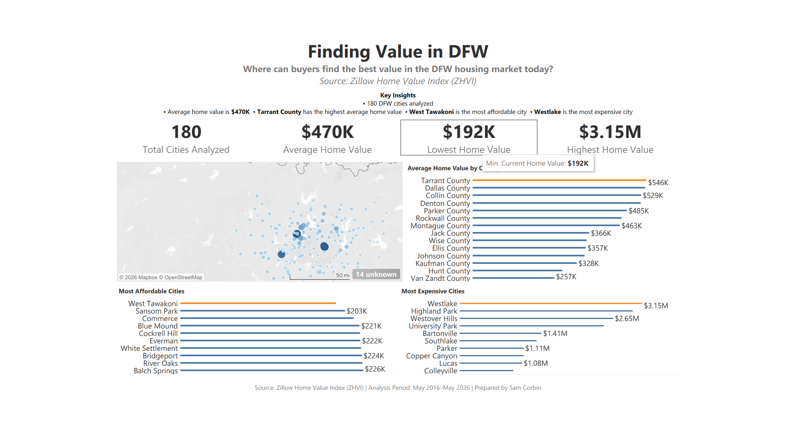
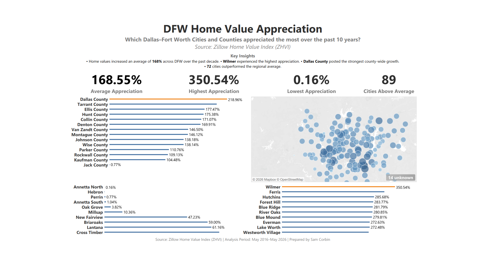
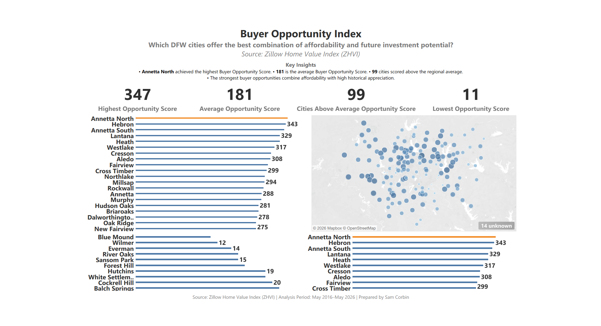
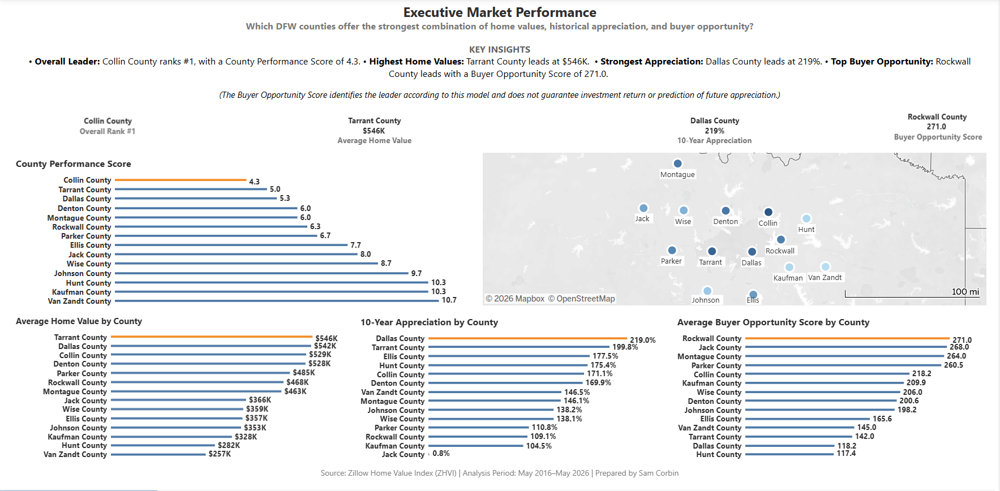

# Finding Value in DFW: A 10-Year Housing Market Analysis

## Project Overview

This project analyzes residential home value trends across the Dallas–Fort Worth (DFW) Metroplex over a 10-year period, from **May 31, 2016, through May 31, 2026**.

Using Zillow Home Value Index (ZHVI) data, the analysis explores current home values, long-term appreciation, buyer opportunity, and county-level market performance. The goal is to turn housing market data into actionable insights that can support homebuyers, real estate professionals, and market researchers.

The project uses SQL in Google BigQuery to prepare and analyze the data, Tableau to create interactive dashboards, and Excel and Power Query to support data validation and preparation.

---

## Project Objectives

The project was designed to answer the following questions:

* Which DFW cities currently have the lowest and highest home values?
* Which cities have experienced the strongest and weakest home value appreciation over the past decade?
* Where might buyers find a combination of relatively affordable home values and strong long-term appreciation?
* How do DFW counties compare across home values, appreciation, and buyer opportunity?
* Which areas may warrant further research by buyers and real estate professionals?

---

## Tools and Technologies


| Tool            | Purpose                                                            |
| --------------- | ------------------------------------------------------------------ |
| Google BigQuery | Data storage, SQL analysis, and query development                  |
| SQL             | Data filtering, aggregation, ranking, and metric calculation       |
| Tableau         | Interactive dashboard development and visualization                |
| Microsoft Excel | Data review and validation                                         |
| Power Query     | Data preparation and transformation                                |
| GitHub          | Project documentation, version control, and portfolio presentation |


---

## Data Source and Methodology

### Data Source

The analysis uses the **Zillow Home Value Index (ZHVI)** dataset, which provides estimated home values across geographic markets.

The dataset was imported into Google BigQuery for analysis. The primary BigQuery table is:

`dfw_housing_analysis.housing_data`

### Analysis Period

The official analysis period is:

* **Starting observation:** May 31, 2016
* **Ending observation:** May 31, 2026
* **Duration:** 10 years

The latest-home-value analysis uses the most recent available observation on or before May 31, 2026.

### Geographic Scope and Eligibility

The current home value snapshot includes **176 eligible cities across 13 counties**.

The 10-year appreciation and Buyer Opportunity Index analyses include **167 cities across the same 13 counties**. These analyses require valid home value observations at both the beginning and ending dates of the analysis period.

Nine cities were excluded from the appreciation-based analyses because they did not have a qualifying May 31, 2016 observation. They were not assigned fabricated or estimated starting values.

The following cities were excluded from the project’s analysis:

* Fairview
* Lantana
* Perrin

### Key Methodology

**Latest Home Value**

The latest home value for each city is based on the most recent available observation on or before May 31, 2026.

**10-Year Home Value Appreciation**

Appreciation is calculated using the home value at the beginning and end of the analysis period:

$$
\text{Appreciation (\%)} =
\frac{\text{Ending Home Value} - \text{Starting Home Value}}
{\text{Starting Home Value}} \times 100
$$

Cities must have valid observations at both endpoints to be included.

**County Average Appreciation**

County appreciation is calculated as the unweighted average of the appreciation percentages for eligible cities within each county.

**Buyer Opportunity Index**

The Buyer Opportunity Index combines city-level affordability and 10-year appreciation rankings.

* Affordability rank: lower home values receive better ranks.
* Appreciation rank: higher appreciation receives better ranks.
* Buyer Opportunity Score: the sum of the affordability and appreciation ranks.
* Buyer Opportunity Rank: cities are ranked by their combined score, with lower scores indicating stronger opportunity.

The index is a comparative screening tool. It does not account for every factor that influences an individual home purchase, such as mortgage rates, taxes, insurance, property condition, or household finances.

**County Performance Score**

The County Performance Score is calculated as the average of three county rankings:

1. Average home value rank
2. Average appreciation rank
3. Average Buyer Opportunity rank

A lower County Performance Score indicates stronger overall performance across the three measures.

---

## Dashboard Overview

The project includes four Tableau dashboards.

### Dashboard 1 — Current Market Snapshot

Provides a snapshot of current home values across the DFW Metroplex.

The dashboard supports comparisons between cities and helps identify areas with relatively low or high estimated home values.

### Dashboard 2 — Home Value Appreciation

Examines 10-year home value appreciation from May 31, 2016, through May 31, 2026.

The dashboard highlights city-level appreciation, county-level comparisons, and the strongest and weakest appreciation outcomes.

**Key findings:**

* Average city appreciation was approximately **89%**.
* **Wilmer** had the highest appreciation at **184.74%**.
* **Lavon** had the lowest appreciation at **41.93%**.
* **81 cities** had appreciation above the overall city average.

### Dashboard 3 — Buyer Opportunity Index

Combines relative affordability and 10-year appreciation to identify cities that may offer a favorable balance between current home values and historical growth.

**Key findings:**

* **Sansom Park** had the strongest Buyer Opportunity Index result, with a score of **8**.
* The average Buyer Opportunity Score was **168**.
* **87 cities** had scores above the average score.
* **Frisco** had the highest numeric score at **300**, representing the weakest result under this index.

**Interpretation:** A lower Buyer Opportunity Score indicates a stronger result. A high numeric score should not be interpreted as a better buying opportunity.

### Dashboard 4 — Executive Market Performance

Compares the 13 counties across average home values, appreciation, and Buyer Opportunity Index performance.

The dashboard combines these measures into a County Performance Score to provide a high-level comparison of overall county performance.

**Key findings:**

* **Tarrant County** ranked first overall, with a County Performance Score of **4.33**.
* Tarrant County had the highest average home value, at approximately **$537,000**.
* **Hunt County** had the highest average city appreciation at **119.75%**.
* **Van Zandt County** had the strongest average Buyer Opportunity result, with the lowest average Buyer Opportunity Score of **50.00**.
* **Rockwall County** ranked last overall, with a County Performance Score of **10.33**.

---

## Key Business Insights

### 1. Home values and appreciation are not the same thing

A city with a high current home value is not necessarily a city with the strongest historical appreciation. Evaluating both measures provides a more complete view of the market.

### 2. Relative affordability can reveal additional opportunities

Some cities with comparatively lower home values have also experienced substantial appreciation. The Buyer Opportunity Index helps identify these combinations rather than relying on affordability or appreciation alone.

### 3. County-level results can conceal city-level variation

County averages provide useful context, but individual cities within the same county can have very different home value and appreciation patterns. City-level analysis remains important when evaluating a specific market.

### 4. A ranking is a screening tool, not a purchase recommendation

The Buyer Opportunity Index and County Performance Score are designed to compare markets using the selected metrics. They do not replace property-level due diligence or a buyer’s financial analysis.

---

## Recommendations

Based on the findings, the following actions may be useful for further market research:

* **Explore cities with lower Buyer Opportunity Scores.** These cities combine stronger relative affordability and appreciation rankings under the project’s methodology.
* **Compare current home values with historical appreciation.** A city’s current price alone does not describe its long-term performance.
* **Investigate county averages at the city level.** County results can mask meaningful differences between individual markets.
* **Use the dashboards as a starting point for deeper research.** Buyers and real estate professionals should also consider taxes, insurance, financing costs, inventory, neighborhood conditions, and property-specific factors.

These recommendations are based on historical ZHVI data and should not be interpreted as predictions of future home value performance.

---

## Project Structure

```text
dfw-housing-market-analysis/
│
├── data/
│   ├── latest_home_values.csv
│   ├── city_appreciation.csv
│   ├── county_appreciation.csv
│   ├── buyer_opportunity_index.csv
│   └── county_performance.csv
│
├── dashboards/
│   ├── dashboard_1_current_market_snapshot
│   ├── dashboard_2_home_value_appreciation
│   ├── dashboard_3_buyer_opportunity_index
│   └── dashboard_4_executive_market_performance
│
├── sql/
│   └── analysis_queries.sql
│
├── documentation/
│   ├── executive_summary.pdf
│   ├── methodology.pdf
│   └── data_dictionary.pdf
│
└── README.md
```

*Note: The directory structure above is a documentation example. Adjust the names and folders to match the files actually present in the repository.*

---

## Data Quality and Validation

Data validation was performed before refreshing the dashboards.

Validation checks included:

* Confirming expected row counts and unique city or county records.
* Checking for missing values and duplicate records.
* Confirming that the latest home value dataset uses the correct ending observation date.
* Verifying that appreciation calculations use the fixed 10-year endpoints.
* Confirming that appreciation-based analyses include only cities with valid observations at both endpoints.
* Comparing county appreciation averages against the city-level data.
* Verifying Buyer Opportunity Scores against the sum of affordability and appreciation ranks.
* Confirming Buyer Opportunity Rank ordering.
* Comparing county performance metrics and rankings against the SQL output.

The validated datasets currently contain:

| Dataset                 |     Records | Geographic Coverage |
| ----------------------- | ----------: | ------------------- |
| Latest Home Values      |  176 cities | 13 counties         |
| City Appreciation       |  167 cities | 13 counties         |
| County Appreciation     | 13 counties | 13 counties         |
| Buyer Opportunity Index |  167 cities | 13 counties         |
| County Performance      | 13 counties | 13 counties         |

The difference between the 176-city current snapshot and the 167-city appreciation-based datasets is intentional and reflects the endpoint eligibility requirements.

---

## Future Improvements

Potential next steps for expanding the project include:

* Incorporating additional housing market indicators.
* Comparing home value trends with local income and affordability measures.
* Analyzing changes in market performance over shorter time periods.
* Adding data on property taxes, mortgage rates, or housing inventory.
* Developing a repeatable process to refresh the data and dashboards as new observations become available.

---

## Project Summary

This project demonstrates an end-to-end data analytics workflow, from preparing and validating a public dataset to developing SQL analyses and interactive Tableau dashboards.

The analysis provides a structured view of the DFW housing market by examining current home values, 10-year appreciation, buyer opportunity, and county-level performance.

The project also demonstrates how data can be transformed into practical market insights while documenting methodology, eligibility requirements, and limitations.

**The central takeaway:** Understanding a housing market requires more than looking at current prices. Combining affordability, historical appreciation, and geographic context provides a more useful foundation for further research and decision-making.


# DFW Housing Market Analysis

**End-to-End Business Intelligence Portfolio Project**

## Project Overview
This project analyzes the Dallas–Fort Worth (DFW) housing market using Zillow Home Value Index (ZHVI) data to identify current market conditions, long-term appreciation trends, and cities offering the strongest buying opportunities.

The analysis combines SQL, BigQuery, Tableau, and Excel to transform raw housing data into interactive dashboards that help buyers, investors, and real estate professionals make data-driven decisions.

The project follows a complete data analytics workflow:

- Data Collection
- Data Cleaning
- SQL Analysis
- Business Intelligence Dashboard Development
- Data Visualization
- Business Recommendations


## Business Problem

Homebuyers and investors often struggle to determine:

- Which cities have appreciated the most over the last decade?
- Which markets remain affordable?
- Which cities offer the strongest balance between affordability and future appreciation?
- Which counties have experienced the strongest housing growth?
- Where should buyers focus today?

This project answers these questions through interactive Tableau dashboards.


## Project Objectives

The objectives of this project were to:

- Analyze current home values across the DFW Metroplex.
- Measure 10-year home value appreciation.
- Compare appreciation across counties and cities.
- Develop a Buyer Opportunity Index combining affordability and appreciation.
- Build interactive dashboards that allow users to explore the market visually.
- Deliver actionable business insights for buyers, investors, and real estate professionals.


## Tools & Technologies

| Tool                               | Purpose                                                         |
| ---------------------------------- | --------------------------------------------------------------- |
| **Google BigQuery (SQL)**          | Data cleaning, transformation, and analysis                     |
| **Tableau**                        | Interactive dashboards and business intelligence visualizations |
| **Microsoft Excel**                | Initial data exploration and validation                         |
| **GitHub**                         | Version control and portfolio hosting                           |
| **Zillow Home Value Index (ZHVI)** | Housing market dataset                                          |


## Datasets

The project uses five analytical datasets generated through SQL queries in Google BigQuery. Each dataset supports a specific stage of the analysis and serves as the foundation for the Tableau dashboards.

| Dataset                         | Description                                                                                                                                                                                                                                                                               |
| ------------------------------- | ----------------------------------------------------------------------------------------------------------------------------------------------------------------------------------------------------------------------------------------------------------------------------------------- |
| **latest_home_values.csv**      | Current Zillow Home Value Index (ZHVI) estimates for each Dallas–Fort Worth city, including county information. Used to analyze current market conditions, calculate KPIs, and identify the highest- and lowest-priced housing markets.                                                   |
| **city_appreciation.csv**       | Ten-year home value appreciation by city (May 2016–May 2026). Used to evaluate historical growth, identify top-performing markets, and compare appreciation trends across the region.                                                                                                     |
| **county_appreciation.csv**     | Average home value appreciation aggregated at the county level. Used to compare long-term market performance between counties and support county-level visualizations.                                                                                                                    |
| **buyer_opportunity_index.csv** | Composite dataset combining current home values, appreciation percentages, affordability rankings, and buyer opportunity scores to identify cities offering the strongest balance of value and growth potential.                                                                          |
| **county_performance.csv**      | Executive-level county performance dataset that combines average home values, appreciation, buyer opportunity scores, ranking metrics, and an overall County Performance Score. Created specifically to support the Executive Market Performance Dashboard and executive decision-making. |


**Source**
Zillow Home Value Index (ZHVI)

The dataset contains housing information for approximately 180 cities across the Dallas–Fort Worth Metroplex, including:

- City
- County
- Current Home Value
- Starting Home Value
- 10-Year Appreciation Percentage
- Buyer Opportunity Score
- Affordability Rank
- Appreciation Rank


## Dashboard Overview


## Dashboard Screenshots


### Dashboard 1 — Current Market Snapshot


Provides a high-level overview of the current DFW housing market, including:

https://public.tableau.com/views/Dashboard1_CurrentMarket/CurrentMarketSnapshot?:language=en-US&:sid=&:redirect=auth&:display_count=n&:origin=viz_share_link

- Average Home Value
- Highest Home Value
- Lowest Home Value
- Cities Above Average
- Average Home Value by County
- Current Home Values by City
- Home Value Bubble Map

---

### Dashboard 2 — Home Value Appreciation


Analyzes historical appreciation over the past decade.

https://public.tableau.com/shared/QZC4F4QQD?:display_count=n&:origin=viz_share_link

Features include:

- Average Appreciation
- Highest Appreciation
- Lowest Appreciation
- Cities Above Average
- Top Appreciating Cities
- Lowest Appreciating Cities
- County Appreciation
- Appreciation Bubble Map

---

### Dashboard 3 — Buyer Opportunity Index


Identifies cities that offer the strongest combination of affordability and appreciation.

https://public.tableau.com/shared/FCBT9BYG9?:display_count=n&:origin=viz_share_link

Features include:

- Highest Opportunity Score
- Average Opportunity Score
- Lowest Opportunity Score
- Cities Above Average
- Opportunity Score by City
- Top Buyer Opportunities
- Lowest Opportunity Cities
- Opportunity Bubble Map

---

### Dashboard 4 — Executive Market Performance


An executive-level county comparison combining average home values, 10-year appreciation, buyer opportunity scores, and an overall County Performance Score. Collin County ranks first overall under the composite scoring model, while the leading county differs across the individual metrics.

Key findings:

- Overall leader: Collin County, with a County Performance Score of 4.3.
- Highest average home value: Tarrant County, approximately $546,000.
- Highest 10-year appreciation: Dallas County, approximately 219%.
- Highest Buyer Opportunity Score: Rockwall County, with a score of 271.0.

Tools: Tableau Public, Google BigQuery, SQL.

https://public.tableau.com/views/ExecutiveMarketPerformance/ExecutiveMarketPerformance?:language=en-US&:sid=&:display_count=n&:origin=viz_share_link

Features include:

- County Performance Score
- Executive KPIs
- County rankings
- County performance map
- Executive insights

Note: The County Performance Score is a composite ranking measure based on three component ranks. A lower score indicates stronger performance under this model. The Buyer Opportunity Score is a model-based comparison, not a guarantee of investment returns.

---

## Key Business Insights

### Current Market

- The average home value across the Dallas–Fort Worth Metroplex is approximately **$321K**.
- Tarrant County currently has the highest average home values among the counties analyzed.
- More than half of DFW cities have home values above the regional average.

### Historical Appreciation

- Home values appreciated an average of **168.55%** over the past ten years.
- Wilmer experienced the highest appreciation at **350.54%**.
- Eighty-nine cities outperformed the regional average appreciation rate.

### Buyer Opportunity Index

- Annetta North achieved the highest Buyer Opportunity Score.
- Ninety-nine cities scored above the regional average opportunity score.
- Top-ranked cities balance affordability with strong historical appreciation, making them attractive to long-term buyers and investors.


## Business Recommendations

Based on this analysis, several recommendations emerge:

- Prioritize buyer outreach in cities with the highest Buyer Opportunity Scores.
- Monitor rapidly appreciating markets for long-term investment potential.
- Use county-level trends to guide regional marketing strategies.
- Balance affordability and appreciation when advising first-time homebuyers.
- Continue updating the dashboards with new Zillow data to monitor changing market conditions.


## Project Structure

DFW-Housing-Market-Analysis
│
├── Data
│
├── SQL
│
├── Tableau
│
├── Images
│
├── Documentation
│
└── README.md


## Future Improvements

Potential enhancements include:

- Integrating live Zillow API data (if available).
- Adding mortgage rate analysis.
- Incorporating school district ratings.
- Including property tax comparisons.
- Developing predictive home value forecasting models.
- Building a Power BI version for cross-platform comparison.


## Project Summary

This project demonstrates practical experience with:

- SQL
- Google BigQuery
- Tableau
- Excel
- Data Cleaning
- Data Visualization
- KPI Design
- LOD Expressions
- Interactive Dashboards
- Business Intelligence
- Geospatial Analysis
- Analytical Storytelling
